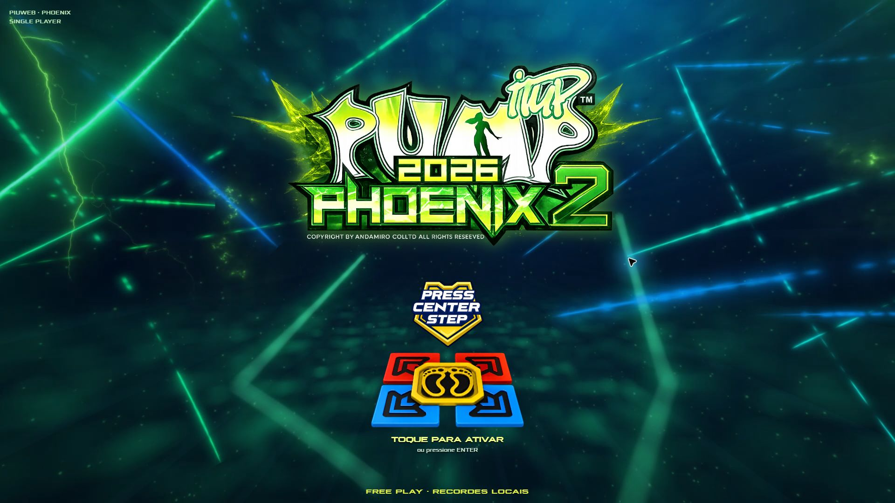
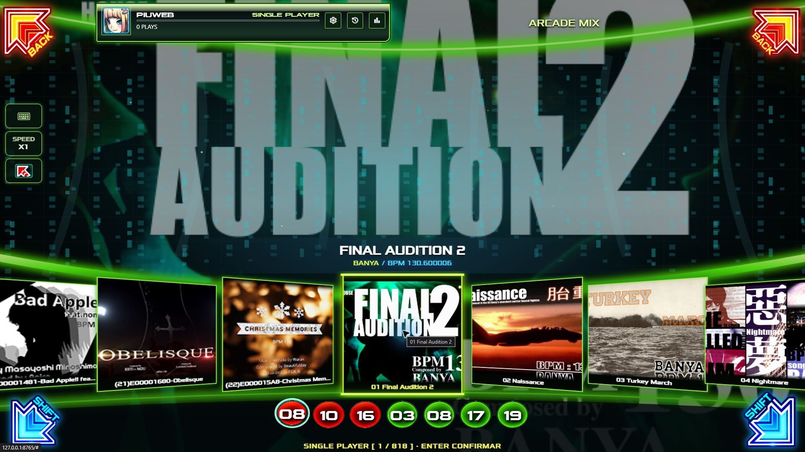
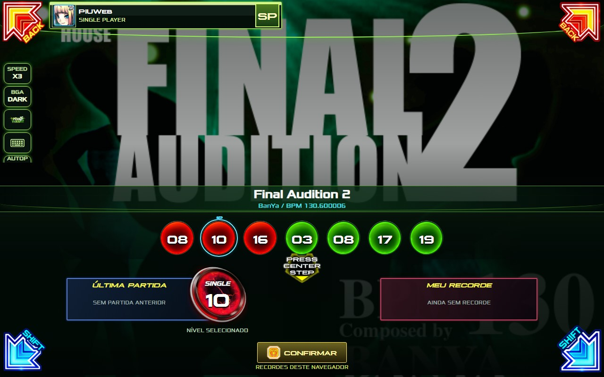
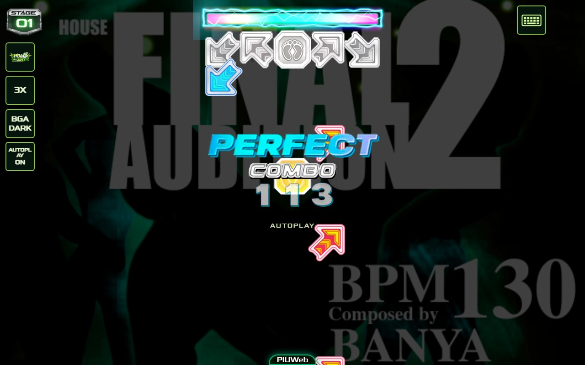
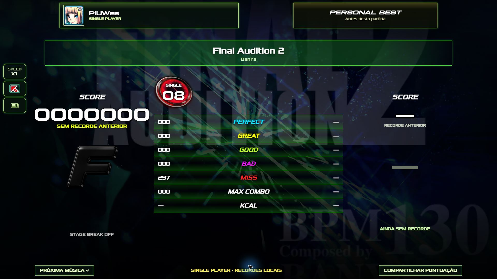

# PIUWeb · Phoenix

Simulador de ritmo para navegador com interface inspirada no Pump It Up Phoenix, seleção de músicas e dificuldades, controles por teclado ou toque e recordes locais. O projeto usa a engine **PIURED** para carregar os charts e executar as partidas.

## Preview

Capturas reais da aplicação executada localmente em desktop. A música usada na demonstração é **Final Audition 2**, de **BanYa**.

### Tela inicial



### Seleção de música



### Seleção de nível



### Jogando



### Score



## Recursos

- Abertura arcade e seleção de músicas por canais, com preview de áudio e favoritos.
- Canais e níveis vazios do Difficulty Zone aparecem com cadeado vermelho e não permitem entrada por clique, toque ou teclado.
- Escolha de charts Single, Double e Half Double, quando disponíveis na música.
- Ajustes de velocidade, velocidade automática, playback, offset e noteskin.
- Controles por teclado e touchpad com ajustes de layout para dispositivos móveis.
- Pausa e retomada da partida, com confirmação para abandonar.
- Resultado com score, classificação, julgamentos, combo e comparação com o recorde pessoal.
- Histórico e recordes salvos no navegador, com opção de compartilhar a pontuação como imagem.
- Manifest e ícones para adicionar o aplicativo à tela inicial.
- Aviso de nova versão nos menus de canais, músicas e níveis, com atualização que preserva os dados locais.

## Executar localmente

O projeto é estático: não exige instalação de dependências nem compilação. No Windows, com Python 3 instalado, execute `iniciar-local.cmd` e mantenha a janela aberta enquanto joga. Também é possível executar na raiz:

```sh
python -m http.server 8765 --bind 127.0.0.1
```

Abra **http://127.0.0.1:8765/** em um navegador com JavaScript, WebGL e áudio habilitados. Use um servidor HTTP para carregar os arquivos e a biblioteca corretamente.

1. Ative a abertura e escolha **Touch to Play**.
2. Escolha o canal e a música.
3. Selecione a dificuldade, revise as configurações e confirme.
4. Se o navegador solicitar uma interação para liberar o áudio, pressione **Iniciar partida**.
5. Ao terminar, confira o resultado e siga para a próxima música.

Nos menus de seleção, o jogo verifica novas versões a cada minuto e ao voltar ao aplicativo. **Atualizar agora** baixa os arquivos e reinicia o jogo, preservando recordes, histórico e preferências. **Agora não** recolhe o aviso para um botão discreto; uma nova versão publicada faz o aviso aparecer novamente. Durante a partida, o aviso fica oculto.

### Controles padrão

As teclas podem ser alteradas nas configurações.

| Painel | ↙ | ↖ | Centro | ↗ | ↘ |
| --- | --- | --- | --- | --- | --- |
| Esquerdo / Single | Z | Q | S | E | C |
| Direito / Double | V | R | G | Y | N |

**Half Double** usa seis sensores: centro, ↗ e ↘ do painel esquerdo (**S, E, C**) e ↙, ↖ e centro do painel direito (**V, R, G**). No toque, aparecem três botões por lado. O editor de touchpad salva tamanho, posição, transparência e campo de jogo separadamente para Half Double, em retrato e paisagem.

O ajuste do touchpad possui perfis **SINGLE**, **DOUBLE** e **HALFDOUBLE**, selecionados automaticamente pelo chart. Cada perfil mantém suas configurações de retrato e paisagem. Salvar ou restaurar uma orientação afeta somente o perfil em uso; ajustes antigos compartilhados são preservados como ponto inicial para Single e Double.

**CO-OP / Routine** é identificado pelas marcações dos participantes no chart, sem depender do nível 99. Esses charts ficam no canal **CO-OP** e não entram no filtro Double do Difficulty Zone. O aplicativo inclui um índice das músicas cooperativas de toda a biblioteca publicada, sem depender da lista parcial do canal ou de visitas prévias a outros canais. Bibliotecas locais e arquivos novos são verificados ao abrir os canais. Músicas com charts individuais e cooperativos também mostram um botão para abrir a opção CO-OP.

O índice publicado em `assets/data/coop-index.json` é gerado pela leitura das notas dos arquivos SSC. Após atualizar a biblioteca, regenere-o com `node scripts/build-coop-index.cjs`. O comando aceita a URL da biblioteca e a data local `YYYY-MM-DD` como argumentos opcionais; arquivos indisponíveis são registrados no índice e não impedem sua geração.

Cada participante tem sua cor nas notas e nos holds: **P1 rosa, P2 azul, P3 amarelo e P4 verde**. A plataforma, a vida e a pontuação são compartilhadas pela equipe. Abra **CONTROLES CO-OP** na confirmação da música ou no menu de pausa para consultar e alterar as teclas dos participantes. Os controles CO-OP são salvos separadamente dos controles individuais. No toque, os participantes compartilham os sensores do modo e seu perfil de touchpad.

O suporte inclui as notas cooperativas do StepF2 e charts `pump-routine` com campos separados por `&`, para até quatro participantes. Routine com notas sobrepostas no mesmo sensor retorna uma mensagem de formato não suportado.

Na seleção desktop, use **← / →** para navegar pelas músicas e **Enter** para confirmar. Durante a partida, **Esc** pausa ou retoma o jogo. Em dispositivos móveis, selecione o modo de controle por toque.

## Biblioteca de músicas

O catálogo e as mídias são carregados de uma biblioteca separada. A origem padrão está definida em [`Demo/SongPicker/Utils.js`](Demo/SongPicker/Utils.js), na variável `resources`, e aponta para `https://danvneitzel.github.io/piu-songs/`.

A biblioteca fornece `songs.json`, charts `.ssc`, arquivos de áudio e imagens. Para usar outra biblioteca, ajuste essa origem e preserve a estrutura esperada pelo carregador. Se estiver em outro domínio, o servidor da biblioteca precisa permitir o acesso aos arquivos via CORS.

Os banners dos canais usam as imagens inclu?das em `assets/img/phx2/channels/`. Para usar um cat?logo local em `localhost` ou `127.0.0.1`, abra `index.html?library=local`: o carregador tenta `/piu-songs/songs.json` no mesmo servidor e usa a biblioteca publicada como alternativa. Sem esse par?metro, usa diretamente o cat?logo publicado.

É necessária conexão para acessar as mídias da biblioteca remota. O manifest e os recordes locais, por si só, não garantem que todas as músicas estejam disponíveis offline. Recordes e preferências ficam associados ao navegador e à origem utilizada; limpar os dados do site remove esses dados.

## Engine

A implementação incluída em [`piured-engine/`](piured-engine/) deriva da **[piured-engine](https://github.com/piulin/piured-engine)**, de **Pedro G. Bascoy (piulin)**. A interface também contém código derivado do projeto **[piured](https://github.com/piulin/piured)**. As informações abaixo descrevem os arquivos desta cópia do projeto.

| Componente | Função |
| --- | --- |
| JavaScript + Three.js | Renderização do palco e dos objetos do jogo em WebGL. |
| Parser SSC | Leitura de metadados, dificuldades e notas de arquivos StepMania SSC. |
| Áudio | Carregamento e sincronização da música, com suporte a MP3 e OGG. |
| Timing | Tratamento de BPM, stops, delays, scrolls, speeds e warps nos módulos de música. |
| Estilos Pump | Charts `pump-single`, `pump-double` e `pump-halfdouble`. |
| Entrada | Configurações de teclado e toque conectadas aos jogadores. |
| Recursos visuais | Noteskins, texturas, geometrias, julgamentos, combo e barra de vida. |

### Fluxo da partida

`index.html` → seleção e configuração → `sessionStorage` → `localStage.html` → engine → resultado → `index.html`

[`Demo/DemoLogic.js`](Demo/DemoLogic.js) prepara a configuração da música e do jogador. [`Demo/LocalStage/RunLocalStage.js`](Demo/LocalStage/RunLocalStage.js) cria a instância de `Engine`, configura o palco com `StageConfig`, adiciona o jogador com `PlayerConfig` e conecta os controles. Ao concluir a música, a aplicação retorna à interface de resultados e registra a jogada no armazenamento local.

O ponto principal da engine é [`piured-engine/js/Engine.js`](piured-engine/js/Engine.js). A existência de abstrações para múltiplos jogadores na engine não implica que esta interface single player ofereça partidas online.

## Estrutura

```text
.
├── index.html            # Abertura, seleção, configurações e resultados
├── localStage.html       # Página da partida
├── Demo/                 # Integração da interface com a engine e a biblioteca
├── piured-engine/        # Engine, bibliotecas e recursos do palco
├── assets/               # Estilos, scripts e imagens da interface
├── icon/                 # Ícones do aplicativo
├── docs/images/          # Capturas usadas neste README
└── manifest.json         # Metadados para instalação na tela inicial
```

## Créditos e licença

Os cabeçalhos dos arquivos derivados da PIURED indicam **GNU GPL versão 3 ou posterior**. O texto da licença está em [`piured-engine/LICENSE`](piured-engine/LICENSE); preserve os avisos de autoria e licença ao redistribuir esses arquivos. Bibliotecas de terceiros mantêm suas próprias licenças.

Pump It Up, as marcas, músicas e artes exibidas pertencem aos respectivos titulares. A licença da engine não concede direitos sobre esses conteúdos.
